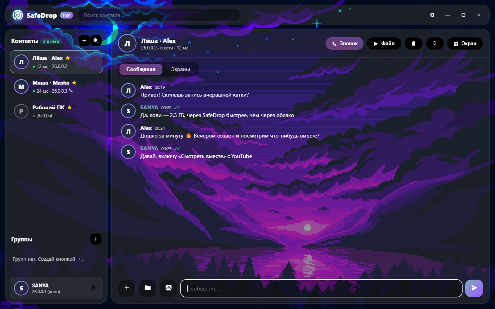
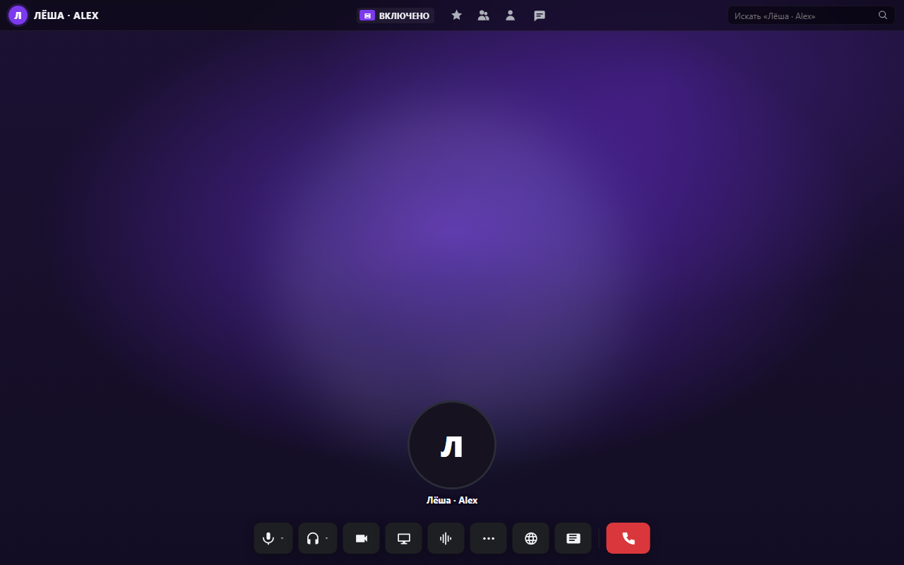
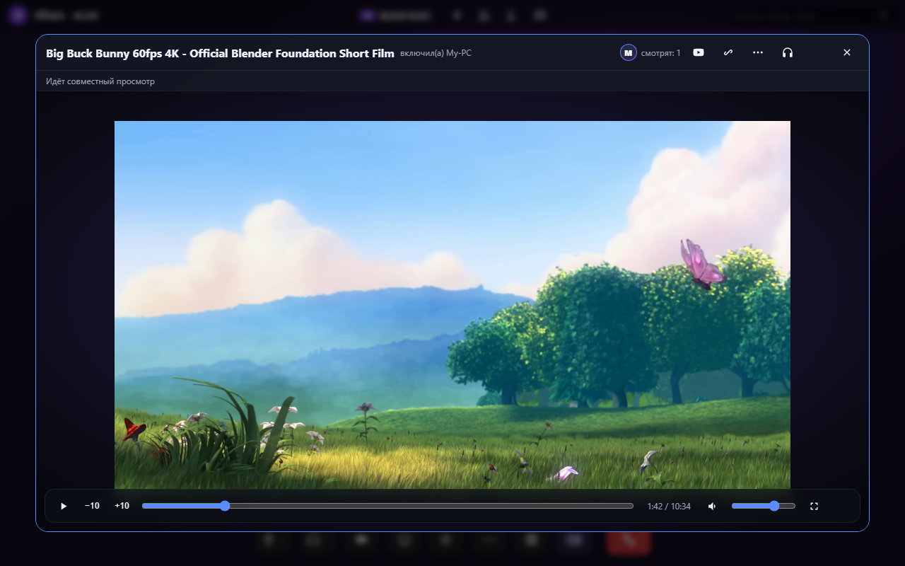
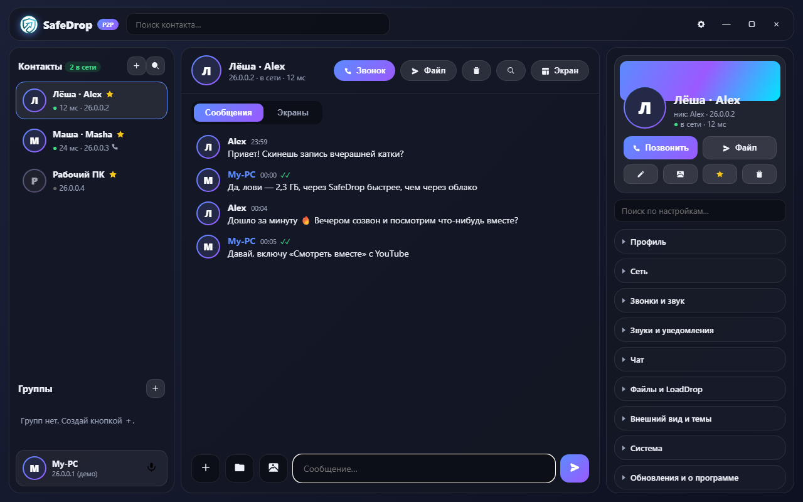

<div align="center">


# SafeDrop

**Файлы, чат, звонки и совместный просмотр — напрямую между компьютерами, без облаков и серверов.**

[](https://github.com/SANYA3212/safedrop/releases/latest)


[](LICENSE)

[Скачать](https://github.com/SANYA3212/safedrop/releases/latest) · [Возможности](#возможности) · [Установка](#установка) · [Настройки](#настройки) · [Сборка](#сборка-из-исходников) · [Изменения](CHANGELOG.md)



</div>

---

## Что это

SafeDrop — настольное приложение для Windows, которое соединяет несколько компьютеров **напрямую** (peer-to-peer) внутри одной сети: домашней, офисной или виртуальной вроде [Radmin VPN](https://www.radmin-vpn.com/ru/). Файлы любого размера, сообщения, голосовые звонки и демонстрация экрана идут от компьютера к компьютеру — без регистрации, аккаунтов и промежуточных серверов.

## Возможности

**📁 Файлы**
- Отправка файлов и папок любого размера (папки упаковываются в zip автоматически), прогресс и скорость
- Приём в папку `LoadDrop`, защита от перезаписи (`файл (1).ext`), проверка SHA-256
- Автоприём от доверенных контактов с лимитом по размеру, остальные — по подтверждению
- Пункт **«Отправить в SafeDrop»** в контекстном меню Проводника

**💬 Чат**
- Личные и групповые чаты, картинки и голосовые/аудио в сообщениях
- Ответы, правка, реакции, удаление, «печатает…», галочки доставки
- Поиск по чату и по всем перепискам, синхронизация истории между компьютерами

**📞 Звонки**
- Звонки 1:1 и групповые, камера, демонстрация экрана **со звуком**, просмотр в мини-окне (PiP)
- Шумодав **RNNoise** (нейросеть, работает локально) или встроенный WebRTC, громкость каждого участника
- Интерфейс звонка в стиле Discord, оформление настраивается

**🎬 Смотреть вместе**
- Синхронный плеер YouTube прямо в звонке: пауза, перемотка и смена видео у всех сразу, управляет любой участник
- Большое окно, мини-окно (перетаскивается и меняет размер), полный экран, **фоновый режим** — музыка играет, пока вы смотрите демонстрацию друга
- Корректная работа с вертикальными видео (Shorts) и рекламой

**🌐 Браузер вместе**
- Встроенный браузер для любых сайтов со стартовой страницей и поиском
- **«Листать вместе»**: друг видит страницы, которые вы открываете, и может листать сам; пауза и перемотка видео на сайтах синхронизируются
- Сайты в браузере изолированы: у них нет доступа к командам приложения

**🔒 Безопасность**
- Файлы и сообщения шифруются (TLS 1.3) между версиями 0.3.26+, звонки и демонстрация — WebRTC (DTLS-SRTP)
- Докачка: при обрыве связи передача продолжается с того же места

**⚙️ Прочее**
- Автопоиск контактов в сети Radmin (`26.x.x.x`) и в локальных подсетях, пинг и статус «в сети»
- Темы: градиент, цвет или картинка, стекло, акцент, скругления, шрифт, свой CSS
- Трей, автозапуск, уведомления Windows
- Раздача обновлений контактам: приложение само предлагает отправить новую версию другу со старой

## Скриншоты

| Звонок | Смотреть вместе |
|---|---|
|  |  |

| Настройки |
|---|
|  |

> Скриншоты сделаны в демо-режиме с примерными контактами и [оформлением автора](#оформление-автора).

## Установка

1. Скачайте `SafeDrop_<версия>_x64-setup.exe` со страницы [**Releases**](https://github.com/SANYA3212/safedrop/releases/latest) и запустите.
2. Нужен **WebView2 Runtime** — в Windows 10/11 он обычно уже есть ([скачать](https://developer.microsoft.com/microsoft-edge/webview2/)).
3. Компьютеры должны «видеть» друг друга: одна локальная сеть или общая сеть [Radmin VPN](https://www.radmin-vpn.com/ru/).
4. Разрешите SafeDrop в брандмауэре (кнопка есть в **Настройки → Сеть → Диагностика**) или откройте порты вручную:

| Порт | Протокол | Назначение |
|---|---|---|
| 47831 | TCP | передача файлов |
| 47832 | TCP | чат, звонки, профили, синхронизация |
| 47833 | UDP | QUIC-транспорт (бета, по желанию) |

Какие версии выбрать: **последний релиз** — все новые функции; **`0.3.16-stable`** — проверенная старая версия без совместного просмотра.

## Быстрый старт

1. Запустите SafeDrop на обоих компьютерах. Через несколько секунд контакты из той же сети появятся сами; иначе нажмите **«+»** и введите IP друга.
2. Выберите контакт — откроется чат. Перетащите файл в окно или нажмите **«Файл»**.
3. **«Звонок»** — голосовой звонок. В звонке доступны камера, демонстрация экрана, **«Смотреть вместе»** и **браузер**.
4. Чтобы смотреть видео вместе: в звонке нажмите **«Смотреть вместе»** → вставьте ссылку YouTube или откройте **YouTube** в браузере приложения и нажмите **«Смотреть вместе»** на странице видео.

## Настройки

Настройки открываются шестерёнкой в верхней панели, по ним есть поиск.

| Раздел | Что настраивается |
|---|---|
| **Профиль** | Ник и аватар, которые видят ваши контакты |
| **Сеть** | Ваши адреса, скан сети по подсетям, имя устройства, порт файлов, QUIC-транспорт (бета), диагностика и правило брандмауэра |
| **Звонки и звук** | Микрофон, динамики, камера, громкость; шумодав (RNNoise / WebRTC / выкл., сила, порог, эхо, автогромкость); вид экрана звонка (плитки, аватары, цвета, фон, логотип); звуки гудка, вызова, входа и выхода участников |
| **Звуки и уведомления** | Звуки сообщений и файлов, уведомления Windows |
| **Чат** | Показывать ли, что вы печатаете |
| **Файлы и LoadDrop** | Папка приёма (по умолчанию `Загрузки\LoadDrop`), автоприём от доверенных и лимит в МБ |
| **Внешний вид и темы** | Фон, стекло, плотность, акцент, градиент кнопок, скругления, цвета текста и ссылок, шрифт, свой CSS, пресеты, экспорт и импорт темы |
| **Система** | Автозапуск, сворачивание в трей, пункт в меню Проводника |
| **Обновления** | Текущая версия и раздача установщика контактам |

Все данные хранятся локально в `%APPDATA%\safedrop` (`settings.json`, `peers.json`, `chats.json`, `groups.json`, `history.json`).

## Оформление автора

Так SafeDrop настроен у автора — именно это оформление на скриншотах. Тему можно поставить в один клик: **Настройки → Внешний вид и темы → Импорт** → [`themes/sanya.safedrop-theme.json`](themes/sanya.safedrop-theme.json) (картинку фона выберите свою).

| Параметр | Значение |
|---|---|
| Фон | картинка (пиксель-арт, фиолетовый закат), стекло 0 px, плотность 50 % |
| Акцент | `#82abbf` |
| Градиент активных кнопок | `#62468b` → `#693870`, 206° |
| Кнопки и текст | кнопки `#000000`, текст `#ffffff`, приглушённый `#c6c3c3`, ссылки `#37ff00` |
| Скругление, шрифт | 18 px, Segoe UI |
| Экран звонка | градиент `#21152e` → `#14004d`, плитка 160 px, аватар 120 px, кольцо речи `#23a43d` 2 px, имена видны, логотип скрыт |
| Шумодав | RNNoise, сила 100 %, эхоподавление и автогромкость включены |
| Звуки | свои мелодии для входящего звонка, выхода участника, сообщений и файлов; гудок «классический», вход участника «срочный» |
| Система | автозапуск, сворачивание в трей, пункт в меню Проводника |

## Как это работает

```
 ПК 1                                          ПК 2
┌──────────────────────┐   TCP 47831 файлы   ┌──────────────────────┐
│ WebView2 (HTML/JS)   │ ◄─────────────────► │ WebView2 (HTML/JS)   │
│  интерфейс, WebRTC   │   TCP 47832 сигналы │  интерфейс, WebRTC   │
│ Rust (Tauri 2)       │ ◄─────────────────► │ Rust (Tauri 2)       │
│  сеть, файлы, данные │   WebRTC звук/видео │  сеть, файлы, данные │
└──────────────────────┘ ◄═════════════════► └──────────────────────┘
```

- **Rust** (`src-tauri/`) — сервер сигналов, передача файлов, поиск контактов, хранение данных, окно браузера.
- **Интерфейс** (`src/`) — обычные HTML, CSS и JavaScript без фреймворков; звонки и демонстрация экрана — WebRTC.
- **Сообщения** — JSON-кадры по TCP; старые версии просто пропускают незнакомые типы, поэтому разные версии совместимы.
- **Шифрование** — TLS 1.3 поверх тех же портов (с 0.3.26): сервер по первому байту отличает зашифрованное соединение от старого. Ключ самоподписанный, без проверки собеседника: защищает от подслушивания по дороге, но не от подмены.
- Серверов нет: всё идёт напрямую между компьютерами в сети.

## Сборка из исходников

Нужны [Rust](https://rustup.rs/) (stable), [Tauri CLI](https://tauri.app/) (`cargo install tauri-cli`) и WebView2.

```bat
:: запуск в режиме разработки
start.bat

:: релизная сборка: exe, расширение Проводника и установщик в update\
build-release.bat
```

Версия задаётся в `src-tauri/Cargo.toml` и `src-tauri/tauri.conf.json` (там же имя ресурса `safedrop-shell-<версия>.dll`) — они должны совпадать.

**Демо без сборки:** запустите в корне `python -m http.server 8799` и откройте `http://127.0.0.1:8799/src/index.html` (добавьте `?demo-call`, чтобы сразу открыть экран звонка). Сеть в демо-режиме не работает — только интерфейс.

## Структура проекта

```
src/                 интерфейс: index.html, app.js, styles.css, браузерная панель
src/vendor/rnnoise/  шумодав RNNoise (WASM)
src-tauri/src/       Rust: main.rs, signal.rs (кадры), transfer.rs, quic.rs,
                     discovery.rs (поиск), state.rs, ytbrowse.rs (окно браузера)
src-shell/           расширение Проводника «Отправить в SafeDrop»
themes/              готовые темы оформления
docs/screenshots/    скриншоты для README
```

## Изменения

История версий — в [CHANGELOG.md](CHANGELOG.md), установщики — на странице [Releases](https://github.com/SANYA3212/safedrop/releases).

## Лицензия

[MIT + Commons Clause](LICENSE): код можно свободно использовать, изучать, менять и распространять, в том числе в своих проектах, — **но продавать SafeDrop или продукты и услуги, ценность которых в основном и состоит в SafeDrop, запрещено.** При распространении сохраняйте текст лицензии.

Сторонние компоненты сохраняют свои лицензии: RNNoise — BSD (`src/vendor/rnnoise/`).
